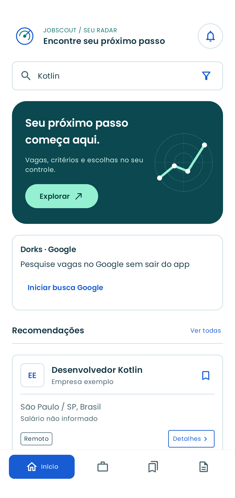
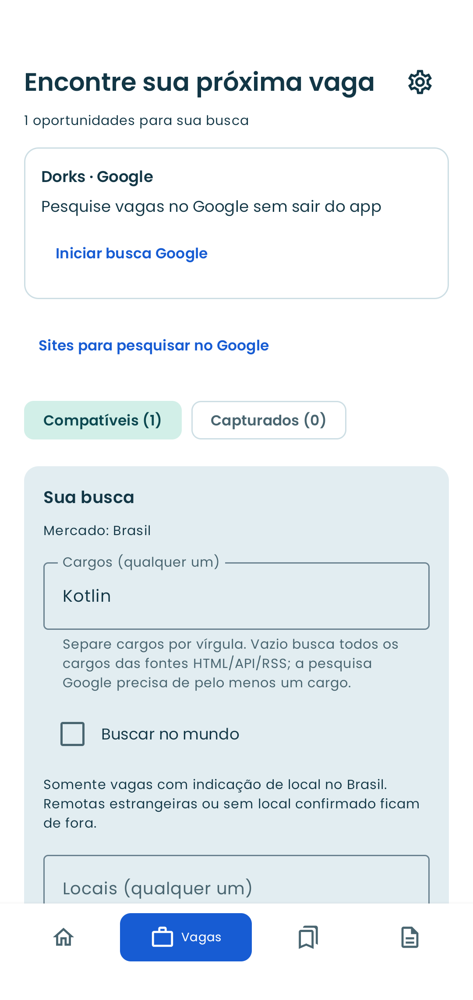
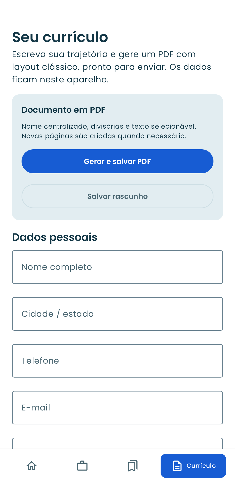

<h1 align="center">JobScout Community</h1>

<p align="center">
  Encontre vagas, acompanhe candidaturas e prepare seu currículo no Android.
</p>

<p align="center">
  
  
  <a href="LICENSE"></a>
</p>

<p align="center">
  <a href="#recursos">Recursos</a> ·
  <a href="#capturas-de-tela">Capturas de tela</a> ·
  <a href="#instalação">Instalação</a> ·
  <a href="#desenvolvimento">Desenvolvimento</a> ·
  <a href="#contribuindo">Contribuindo</a>
</p>

JobScout Community é um aplicativo Android de código aberto para organizar sua busca por trabalho. Reúne vagas de fontes públicas, compara oportunidades com seu perfil e permite criar um currículo em PDF.

**Sem cadastro no JobScout, sem backend próprio e sem telemetria.** O processamento do currículo e o armazenamento dos seus dados acontecem no aparelho. A consulta de vagas usa conexão com as fontes habilitadas.

## Recursos

- **Busca de vagas:** cargos, palavras-chave, cidades, modalidade, senioridade, contrato, salário, empresas e período, com filtros locais e buscas salvas.
- **Brasil ou mundo:** recorte brasileiro por padrão, com opção de busca internacional e controle de vagas remotas fora das cidades escolhidas.
- **Compatibilidade explicável:** pontuação por habilidades, experiência, objetivos e localização, com pesos ajustáveis e indicação dos critérios encontrados ou ausentes.
- **Google assistido:** consultas por domínio no navegador interno, captura de links e pausa para intervenção humana quando houver CAPTCHA.
- **Favoritos e candidaturas:** vagas salvas, notas, datas e acompanhamento das etapas da candidatura.
- **Currículo em PDF:** importação local com revisão dos campos, editor por seções e exportação do documento.
- **Histórico local:** preserve suas vagas salvas e remova as demais com confirmação.
- **Atualizações opcionais:** varredura ao abrir, agendamento de melhor esforço e notificações de novas vagas relevantes.

## Capturas de tela

<p align="center">
  
  
  
</p>

<p align="center"><em>Início · Vagas · Currículo. Telas com dados de exemplo.</em></p>

## Instalação

Requer **Android 8.0 (API 26) ou superior** e internet para consultar vagas.

Para instalar a partir do código-fonte, siga as instruções de [compilação](#desenvolvimento) e transfira o APK gerado para o aparelho. Autorize a instalação pelo aplicativo usado para abrir o arquivo quando o Android solicitar.

Os comandos deste README geram um **APK de desenvolvimento**, com o identificador `com.jobscout.community`. Atualizações sobre uma instalação existente precisam usar o mesmo identificador e certificado de assinatura.

## Primeiros passos

1. Defina seus cargos, locais e preferências de busca no primeiro acesso.
2. Em **Vagas → engrenagem**, revise as fontes habilitadas e os pesos de compatibilidade.
3. Inicie uma busca e consulte **Compatíveis** ou **Capturados**. Os capturados podem conter prévias incompletas ou fora dos seus filtros.
4. Confira os detalhes e a publicação original antes de se candidatar. Marque as oportunidades que quiser acompanhar em **Salvas**.
5. Em **Currículo**, preencha as seções ou importe um PDF, revise o rascunho e gere seu documento.

### Fontes disponíveis

| Fonte | Integração | Configuração |
| --- | --- | --- |
| We Work Remotely | RSS público | Disponível na lista de fontes |
| Python.org | Página pública e RSS | Disponível na lista de fontes |
| Google | Busca assistida no navegador interno | Ligada por padrão; pode ser desativada |
| Greenhouse e Lever | APIs públicas de quadros de empresas | Adicione o identificador de cada quadro |
| Freehire | API com chave pessoal | Opcional; configure sua chave e habilite a fonte |
| Vagas.com.br, Empregos.com.br e páginas de carreiras | Coleta HTML | Opcionais; consulte as condições de acesso |

**Freehire:** em **Vagas → engrenagem → Sua chave Freehire**, informe somente a chave da sua conta e habilite a fonte. A credencial é armazenada com AES-GCM e Android Keystore. Os termos e permissões do provedor continuam se aplicando.

O Google restringe acesso automatizado sem permissão expressa. O navegador assistido pausa para CAPTCHA humano; usar este projeto não concede autorização de coleta. Consulte [fontes, acesso e condições de uso](docs/SOURCES.md).

## Privacidade e segurança

Perfil, vagas, notas e rascunhos ficam no armazenamento privado do aplicativo. O PDF importado é processado localmente; o texto bruto e o arquivo não são retidos pelo importador. PDFs exportados ficam no destino escolhido por você.

As fontes recebem seu IP, os termos pesquisados e os dados necessários à conexão. Logos remotos também podem gerar requisições. A chave Freehire é enviada apenas às chamadas desse provedor.

**Apagar todos os dados locais** remove banco, perfil, preferências, cache, sessão do navegador interno e credencial Freehire. Os PDFs que você exportou permanecem no local escolhido.

Leia a [política de privacidade](docs/PRIVACY.md) e as [medidas e limitações de segurança](SECURITY.md). Para reportar uma vulnerabilidade, siga as orientações de `SECURITY.md` e evite incluir dados sensíveis em issues públicas.

## Limitações

- A disponibilidade das fontes e a quantidade de resultados dependem dos provedores. Links indexados podem estar desatualizados; a captura não comprova que uma vaga continua aberta.
- Informações não publicadas permanecem desconhecidas. A pontuação de compatibilidade é uma heurística, não uma probabilidade de contratação.
- A importação de currículo aceita PDFs com texto, até **10 MB e 40 páginas**, e sempre gera um rascunho revisável. Não há OCR para documentos digitalizados.
- O agendamento pode ser atrasado pelo Android. A coleta Google exige o app em primeiro plano e pausa ao sair dele.
- Respostas JSON grandes e PDFs especialmente construídos ainda podem consumir recursos excessivos. Os riscos conhecidos estão descritos em [SECURITY.md](SECURITY.md).

## Desenvolvimento

### Requisitos

- JDK **21**.
- Android SDK **36** e ferramentas de build compatíveis.
- Android Studio para importar e executar o projeto, ou terminal com `ANDROID_HOME` configurado.
- Internet para baixar as dependências na primeira compilação.

Abra a raiz do projeto no Android Studio e aguarde a sincronização do Gradle. Se necessário, configure `sdk.dir` em um `local.properties` local. Use o Gradle Wrapper incluído no repositório.

**Windows — compilação, testes unitários e lint:**

```powershell
powershell -NoProfile -ExecutionPolicy Bypass -File scripts/build.ps1 -Check
```

**Linux/macOS:**

```sh
chmod +x gradlew
./gradlew :app:assembleDebug :domain:test :app:testDebugUnitTest :app:lintDebug
```

APK gerado: `app/build/outputs/apk/debug/app-debug.apk`.

A chave de desenvolvimento é criada localmente em `.tools/debug.keystore` e fica fora do Git. Preserve-a para atualizar seus próprios builds sem trocar o certificado.

### Arquitetura

| Camada | Tecnologias e responsabilidade |
| --- | --- |
| Interface | Kotlin, Jetpack Compose, Material 3, MVVM e StateFlow |
| Domínio | Módulo `domain`: filtros, ranking, normalização, planejamento de consultas e parser de currículo, sem dependência do Android |
| Dados | Room, DataStore, Retrofit, OkHttp e Jsoup; persistência local e conectores de fontes |
| Integrações | Hilt, WorkManager, Android Keystore e PDFBox-Android |

<details>
<summary>Testes instrumentados em emulador</summary>

Use um AVD dedicado: esses testes alteram preferências e dados. Confirme o nome do emulador antes de instalar. Nos exemplos abaixo, o serial é `emulator-5556`; substitua-o explicitamente se necessário.

Compile os APKs de aplicação e testes:

```sh
./gradlew :app:assembleDebug :app:assembleDebugAndroidTest
```

No Windows, use `gradlew.bat` no lugar de `./gradlew`.

```sh
adb -s emulator-5556 emu avd name
adb -s emulator-5556 install -r app/build/outputs/apk/debug/app-debug.apk
adb -s emulator-5556 install -r app/build/outputs/apk/androidTest/debug/app-debug-androidTest.apk
adb -s emulator-5556 shell am instrument -w -r com.jobscout.community.test/androidx.test.runner.AndroidJUnitRunner
```

Evite o runner Gradle conectado quando houver um telefone pessoal presente: ele pode executar testes em todos os dispositivos conectados.

</details>

## Contribuindo

Relatos de bugs, melhorias de acessibilidade, documentação e contribuições de código são bem-vindos.

- **Bugs:** inclua versão do app, versão do Android, passos para reproduzir e o resultado esperado. Remova dados pessoais das capturas e logs.
- **Mudanças:** descreva o problema e a solução no pull request; inclua os testes ou verificações relevantes.
- **Novas fontes:** documente o método de acesso, as condições de uso e as limitações. Mantenha dados fictícios apenas nos testes.

Preserve o processamento local do currículo e não inclua credenciais, bancos de uso pessoal ou chaves de assinatura nas contribuições.

## Licença e créditos

Código próprio sob a licença **[Apache 2.0](LICENSE)**. Consulte [NOTICE](NOTICE) e [THIRD_PARTY_NOTICES.md](THIRD_PARTY_NOTICES.md) para os créditos e as licenças dos materiais de terceiros.

- **Poppins:** SIL Open Font License 1.1.
- **FAANGPath:** referência de layout do currículo, CC BY 4.0.
- **Freehire:** adaptações de código sob MIT.
- **Public Suffix List via OkHttp:** MPL 2.0.

JobScout não possui vínculo declarado com os portais citados. A licença do código não concede direitos sobre serviços, dados, logos ou marcas de terceiros.
